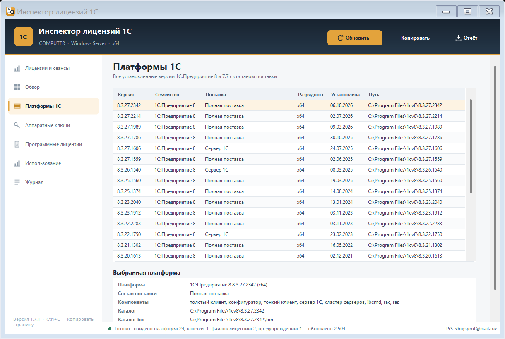
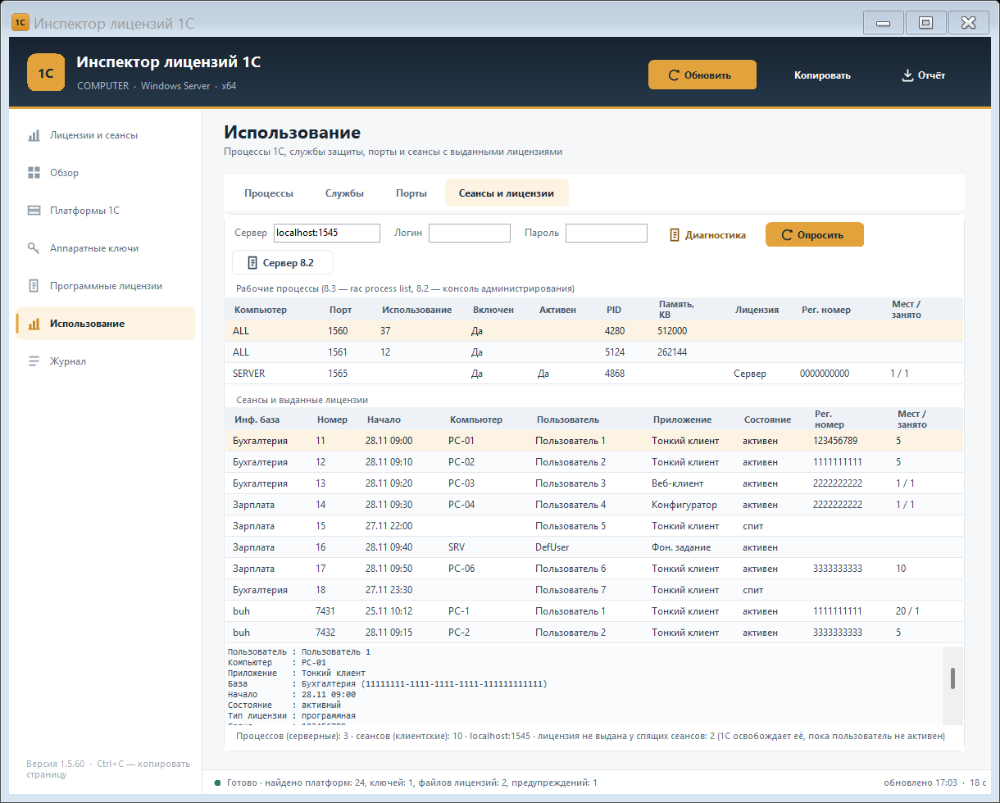

# 1C License Inspector

[](https://github.com/bigsprut/1c-license-inspector/actions/workflows/build.yml)

**Author:** PrS · <bigsprut@mail.ru>

An unofficial Windows utility that audits **1C:Enterprise** licenses on a single machine:
installed platforms, hardware protection keys, software licenses, active sessions
and the licenses they hold.

There is also a **quick build** — `1C-License-Inspector-Lite.exe` (since 1.6.0) with just two
tabs, **Licenses** and **License usage**. It skips hardware keys (Sentinel/HASP), services and
ports, so it starts noticeably faster; both programs share the same collectors, so the numbers
match. Screenshots: `docs/img/lite-licenses.png`, `docs/img/lite-usage.png`.
One self-contained exe, no installation and no third-party libraries. Runs on
**Windows Server 2003 x64** (with .NET Framework 4.0), **Windows Server 2016/2019/2022**
and Windows 7/8/10/11.

*Русская версия: [README.md](README.md)*


## Features

- **1C platforms** — every installed 8.0–8.3 and 7.7 build, bitness, delivery set, paths.
- **Sentinel LDK / HASP HL keys** — keys, features, login limits, used/free seats and sessions
  (read through the local license manager Admin API, port 1947).
- **HASP4 Net** (1C 7.7 / 8.2) — service, version, port 475, configuration; `HASPInfo` output,
  `*.haspinfo` report import and a button to launch HASP Monitor.
- **Software licenses** — `*.lic` files: location, activation date, format, SHA-1; output of
  the 1C `ring` licensing utility when it is installed.
- **Sessions and licenses** — who is connected, from which infobase, which license is held
  and how many seats are used (via `rac` and the 1C 8.3 administration server).
- **Reports** — HTML and CSV, plus a silent mode for scheduled runs.

## Download

Latest release: [Releases page](https://github.com/bigsprut/1c-license-inspector/releases/latest) —
`1C-License-Inspector.exe`, no installer.

| System | Requirement |
|---|---|
| Windows Server 2003 x64 SP2 | .NET Framework 4.0 |
| Windows 7 / 8 / 10 / 11, Server 2008 R2–2022 | .NET Framework 4.x |

## Quick start

```
1C-License-Inspector.exe
1C-License-Inspector.exe /report:C:\Temp\licenses.html /csv:C:\Temp\licenses.csv /silent
```

| Option | Purpose |
|---|---|
| `/report:path.html` | Scan and save an HTML report without showing the window |
| `/csv:path.csv` | Additionally save CSV |
| `/silent` | Suppress error dialogs (for the task scheduler) |
| `/ras:host:port` | 1C administration server address (default `localhost:1545`) |
| `/clusteruser:`, `/clusterpwd:` | Cluster administrator credentials for `rac` |
| `/page:N` | Open the window on section N |
| `/shot:path.png`, `/shotsize:WxH` | Render the window to PNG (diagnostics) |

## Sessions and licenses (rac)

The **Usage → Sessions and licenses** tab lists active cluster sessions and the licenses
they hold: user, host, application, infobase, start time, license type and series,
used and total seats.

Requirements:

- **1C 8.3** platform installed on this machine (it ships `rac.exe`);
- the **1C:Enterprise administration server** service (`ras`, port 1545) running;
- cluster administrator credentials if the cluster requires them.

Credentials are entered on the tab and kept in memory only; they never appear in reports.

## HASP4 key contents

The feature composition inside a HASP4 key (1C 7.7 / 8.2) is not published by the vendor.
It is shown by **HASP Monitor** (HASP4 SDK) or by a saved **HASPInfo** report (`*.haspinfo`).
The program finds `haspinfo.exe` / `haspmntr.exe`, shows `HASPInfo` output, can launch
HASP Monitor and imports saved `*.haspinfo` reports (HASP ID and key type are extracted).

## What is read and what is not

The utility uses documented sources only: it does not guess passwords, bypass protection
or activate anything.

- **Sentinel LDK / HASP HL** — fully readable through the local Admin API (port 1947).
- **HASP4 Net** — service, version, port and settings; key contents only via HASP Monitor.
- **Software licenses** — files and attributes; PIN, edition and seat count are shown by
  the 1C `ring` utility or by 1C itself.
- **Sessions and licenses** — through the documented `rac` tool (1C 8.3).
- **Free seats** are computed for Sentinel LDK keys; a `*.lic` file does not expose the
  seat limit in clear text.

## Collecting data from a server

[`tools/Collect-LicenseData.ps1`](tools/Collect-LicenseData.ps1) is a read-only collector for a
server with software licenses:

```powershell
powershell -ExecutionPolicy Bypass -File .\Collect-LicenseData.ps1
```

It writes `1c-license-data.txt` to the desktop: OS, platforms, `*.lic` files (paths, dates,
SHA-1), `ring` output, registry branches, services, ports, `rac` sessions. License file
**contents are not included** (only with `-IncludeHex`).

## Build

Requires .NET Framework 4.x (`csc.exe`); no external packages.

```powershell
.\build.ps1
```

Output: `build\1C-License-Inspector.exe`. The icon is generated by `tools\make-icon.ps1`,
the manifest lives in `res\app.manifest`.

The compiler is C# 4.0 and the target API surface is .NET 4.0 on purpose, so the exe runs
on Server 2003 with .NET 4.0.

Every tag `v*` is built automatically by GitHub Actions and attached to the release.

## Tested

| System | Result |
|---|---|
| Windows Server 2003 R2 x64 SP2 (1C 7.7) | platform 7.70.027 detected, report generated, no errors |
| Windows Server 2008 R2 (1C 8.2 + HASP4 Net) | 5 platforms, HASP LM 8.31, port 475, Sentinel LDK 15.0 |
| Windows 11 Pro x64 | UI, scanning, reports, sessions (with test `rac` data) |

## Limitations

- Server 2003 requires .NET Framework 4.0.
- `rac` exists only in 1C 8.3; on 8.2 the session list is unavailable.
- If the cluster does not answer on port 1545 or requires a password, sessions are not read —
  the program explains the reason.
- The utility never activates, removes or modifies licenses.

## Author and terms

Author: **PrS**, <bigsprut@mail.ru>.

Not affiliated with 1C. “1C”, “HASP” and “Sentinel” are trademarks of their owners.
Provided as is, without warranty. No license is granted for reuse; contact the author.

## Screenshots

| Platforms | Hardware keys |
|---|---|
|  |  |

| Software licenses | Sessions and licenses |
|---|---|
|  |  |
