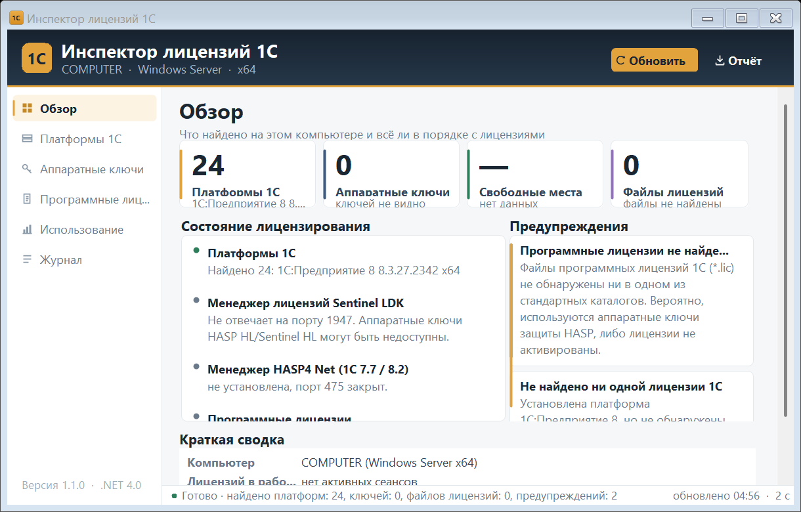
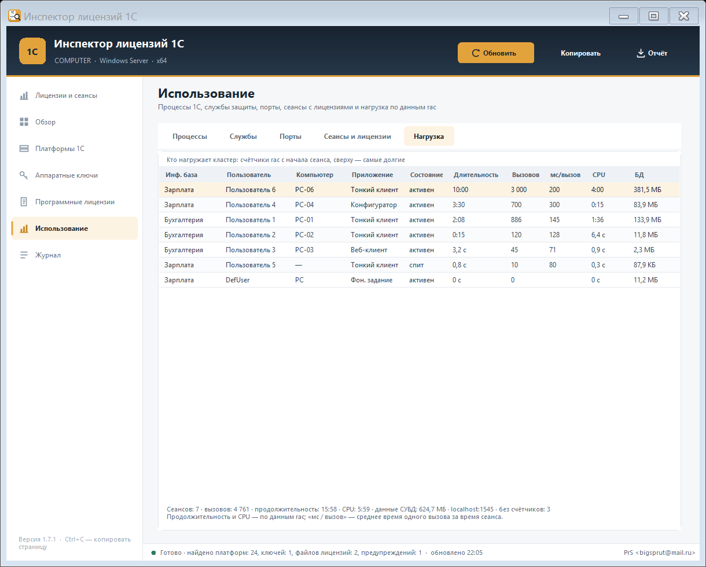
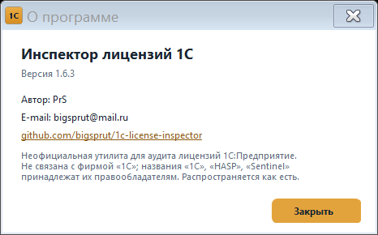
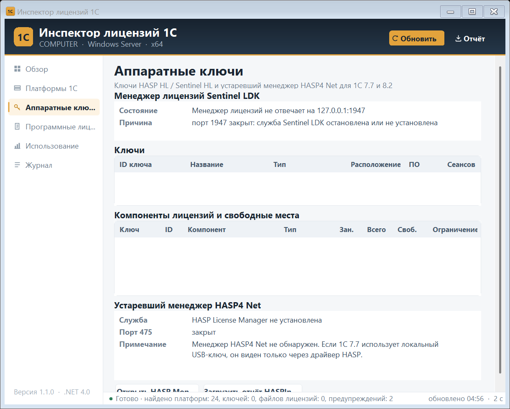
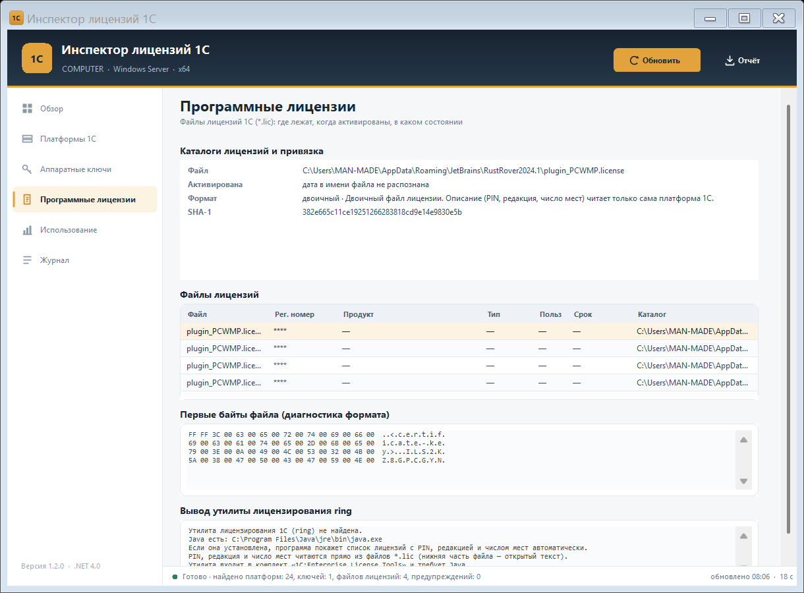
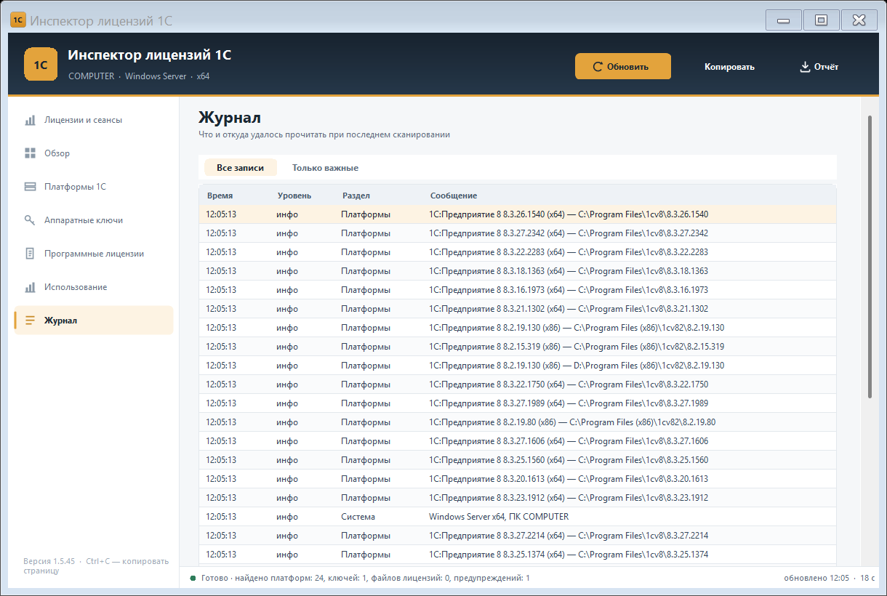

# 1C License Inspector

[](https://github.com/bigsprut/1c-license-inspector/actions/workflows/build.yml)

**Author:** PrS · <bigsprut@mail.ru>

An unofficial Windows utility that audits **1C:Enterprise** licenses on a single machine:
installed platforms, hardware protection keys, software licenses, active sessions
and the licenses they hold — plus who actually loads the cluster.

One self-contained exe, no installation and no third-party libraries. Runs on
**Windows Server 2003 x64** (with .NET Framework 4.0), **Windows Server 2016/2019/2022**
and Windows 7/8/10/11.

*Русская версия: [README.md](README.md)*



## Features

- **1C platforms** — every installed 8.0–8.3 and 7.7 build, bitness, delivery set, components, paths.
- **Sentinel LDK / HASP HL keys** — keys, features, login limits, used/free seats and sessions
  (read through the local license manager Admin API, port 1947).
- **HASP4 Net** (1C 7.7 / 8.2) — service, version, port 475, configuration; `HASPInfo` output,
  `*.haspinfo` report import and a button to launch HASP Monitor.
- **Software licenses** — `*.lic` files: location, activation date, size, format, SHA-1,
  **expiry date**; output of the 1C `ring` utility when it is installed.
- **Licenses and sessions** — what licenses exist (number, type, seats, used, free, expiry date,
  issued by server) and who holds them: user, host, **client IP**, infobase, application, state,
  **last activity**, **seats / used** — via `rac` and the 1C 8.3 administration server.
- **Usage** — 1C and protection processes, services, network ports.
- **Session load** (1.7.0) — who actually loads the cluster: total call duration, CPU time
  and database traffic per session, sorted from the heaviest one down (`rac` counters).
- **Reports** — HTML (for printing and sharing) and CSV, plus a silent mode for scheduled runs.

## Download

Latest release: [Releases page](https://github.com/bigsprut/1c-license-inspector/releases/latest).

Ready to run, no installer: [`dist/1C-License-Inspector.exe`](dist/1C-License-Inspector.exe) (full)
and [`dist/1C-License-Inspector-Lite.exe`](dist/1C-License-Inspector-Lite.exe) (quick build).

**Nothing else has to be copied:** each exe is a single self-contained file for .NET Framework 4.0,
with no installer and no extra libraries. `Mmc20Dump.exe` in the release is an optional standalone
helper for a manual 1C 8.2 console dump — the applications do not need it.

| System | Requirement |
|---|---|
| Windows Server 2003 x64 SP2 | .NET Framework 4.0 |
| Windows 7 / 8 / 10 / 11, Server 2008 R2–2022 | .NET Framework 4.x |

## Quick build: licenses and their usage only

Since 1.6.0 a second exe is built — **`1C-License-Inspector-Lite.exe`** with just two tabs,
**Licenses** and **License usage**. It skips hardware keys (Sentinel/HASP), services and ports,
so it starts noticeably faster; both programs share the same collectors, so the numbers match.
It is a standalone application — the full version is not needed next to it.
Launch it via `Запустить-кратко.cmd`.

Both exes are built from the same sources and differ only in the entry point and the **icon**:
since 1.7.1 both show a license sheet with «1C» and a magnifying glass (so the icon itself says
"view 1C licenses"), amber for the full program and turquoise for the quick one.

Screenshots: `docs/img/lite-licenses.png`, `docs/img/lite-usage.png`.

## About box

**F1** or a click on the **PrS <bigsprut@mail.ru>** signature in the status bar opens the **About**
window: version, author, purpose and shortcuts. The same author is written into the exe metadata
(*Properties → Details*: company `PrS`, copyright `© 2026 PrS <bigsprut@mail.ru>`), into the HTML
report footer and into the first line of the digest.

## Quick start

```
1C-License-Inspector.exe
1C-License-Inspector.exe /report:C:\Temp\licenses.html /csv:C:\Temp\licenses.csv /silent
```

| Option | Purpose |
|---|---|
| `/report:path.html` | Scan and save an HTML report without showing the window |
| `/csv:path.csv` | Additionally save CSV |
| `/silent` | Suppress error dialogs (for the task scheduler) |
| `/ras:host:port` | 1C administration server address (default `localhost:1545`) |
| `/clusteruser:`, `/clusterpwd:` | Cluster administrator credentials for `rac` |
| `/page:N` | Open the window on section N |
| `/shot:path.png`, `/shotsize:WxH` | Render the window to PNG (diagnostics) |

Running it on a server where **only RDP is open** (no WinRM/WMI/SSH): there is a step-by-step
guide in Russian — [docs/РАБОТА-С-СЕРВЕРОМ.md](docs/РАБОТА-С-СЕРВЕРОМ.md) — a tiny worker that
picks up tasks from the project folder, the command list and how to wipe its traces afterwards.

## Sessions and licenses (rac)

The **Usage → Sessions and licenses** tab lists active cluster sessions and the licenses
they hold: user, host, application, infobase, start time, license type and series,
used and total seats.

Requirements:

- **1C 8.3** platform installed on this machine (it ships `rac.exe`);
- the **1C:Enterprise administration server** service (`ras`, port 1545) running;
- cluster administrator credentials if the cluster requires them.

Credentials are entered on the tab and kept in memory only; they never appear in reports.

### Session load (rac)

The **Usage → Load** tab lists the same sessions with their `rac` counters, heaviest first:
`duration-all` (total call time), `calls-all`, average time per call, `cpu-time-total`
and `dbms-bytes-all` (database traffic). The session card on the *Sessions and licenses* tab
breaks the time down into DBMS (`duration-all-dbms`) and 1C code (`duration-all-service`)
and shows the data sent to the client (`bytes-all`).

Counters are cumulative for the session lifetime and exist only in 1C 8.3; with 1C 8.2 the
tab says the cluster does not report them instead of showing zeros.



## HASP4 key contents

The feature composition inside a HASP4 key (1C 7.7 / 8.2) is not published by the vendor.
It is shown by **HASP Monitor** (HASP4 SDK) or by a saved **HASPInfo** report (`*.haspinfo`).
The program finds `haspinfo.exe` / `haspmntr.exe`, shows `HASPInfo` output, can launch
HASP Monitor and imports saved `*.haspinfo` reports (HASP ID and key type are extracted).

## What is read and what is not

The utility uses documented sources only: it does not guess passwords, bypass protection
or activate anything.

- **Sentinel LDK / HASP HL** — fully readable through the local Admin API (port 1947).
- **HASP4 Net** — service, version, port and settings; key contents only via HASP Monitor.
- **Software licenses** — files and their attributes. 1C 8.3 `*.lic` files are readable: the
  bottom of the file exposes the registration number, license type, expiry date and seat count.
  8.2 files are **encrypted** — there PIN, edition and seat count come from the 1C `ring` utility
  or from 1C itself.
- **Sessions and licenses** — through the documented `rac` tool (1C 8.3).
- **Free seats** are computed for Sentinel LDK keys and from the seat count in 8.3 `*.lic` files;
  encrypted 8.2 files do not expose the seat limit in clear text.

## Collecting data from a server

[`tools/Collect-LicenseData.ps1`](tools/Collect-LicenseData.ps1) is a read-only collector for a
server with software licenses:

```powershell
powershell -ExecutionPolicy Bypass -File .\Collect-LicenseData.ps1
```

It writes `1c-license-data.txt` to the desktop: OS, platforms, `*.lic` files (paths, dates,
SHA-1), `ring` output, registry branches, services, ports, `rac` sessions. License file
**contents are not included** (only with `-IncludeHex`).

## Build

Requires .NET Framework 4.x (`csc.exe`); no external packages.

```powershell
.\build.ps1
```

Output: `build\1C-License-Inspector.exe`. The icon is generated by `tools\make-icon.ps1`,
the manifest lives in `res\app.manifest`.

The compiler is C# 4.0 and the target API surface is .NET 4.0 on purpose, so the exe runs
on Server 2003 with .NET 4.0.

Every tag `v*` is built automatically by GitHub Actions and attached to the release.

## Tested

| System | Result |
|---|---|
| Windows Server 2003 R2 x64 SP2 (1C 7.7) | platform 7.70.027 detected, report generated, no errors |
| Windows Server 2008 R2 (1C 8.2 + HASP4 Net) | 5 platforms, HASP LM 8.31, port 475, Sentinel LDK 15.0 |
| Windows 11 Pro x64 | UI, scanning, reports, sessions (with test `rac` data) |

## Limitations

- Server 2003 requires .NET Framework 4.0.
- `rac` exists only in 1C 8.3; on 8.2 the session list is unavailable.
- If the cluster does not answer on port 1545 or requires a password, sessions are not read —
  the program explains the reason.
- The utility never activates, removes or modifies licenses.

## Author and terms

Author: **PrS**, <bigsprut@mail.ru> · [github.com/bigsprut](https://github.com/bigsprut).

The author is also shown inside the app: **PrS <bigsprut@mail.ru>** in the status bar
(click it — or press **F1** — for the About box), in the exe metadata (company/copyright),
in the HTML report and in the text digest.



Not affiliated with 1C. “1C”, “HASP” and “Sentinel” are trademarks of their owners.
Provided as is, without warranty. No license is granted for reuse; contact the author.

## Screenshots

| Platforms | Hardware keys |
|---|---|
|  |  |

| Software licenses | Sessions and licenses |
|---|---|
|  |  |
|  |  |
