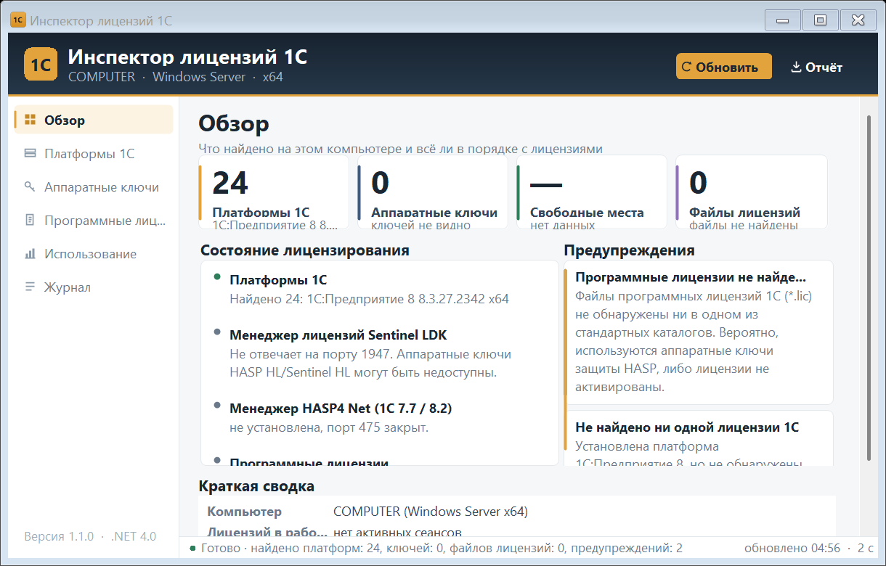

# 1C License Inspector · Инспектор лицензий 1С

[](https://github.com/bigsprut/1c-license-inspector/actions/workflows/build.yml)

Неофициальная утилита для Windows, которая показывает, какие **лицензии 1С:Предприятие**
используются и доступны на компьютере: платформы, аппаратные ключи HASP/Sentinel,
программные лицензии и текущую нагрузку.

**Автор:** PrS · <bigsprut@mail.ru>

*English version: [README.en.md](README.en.md)*



## Возможности

- **Платформы 1С** — все установленные версии 8.0–8.3 и 7.7: разрядность, состав поставки,
  компоненты, путь.
- **Аппаратные ключи Sentinel LDK / HASP HL** — ключи, компоненты, лимиты, занято и свободно, сеансы
  (локальный Admin API менеджера лицензий, порт 1947).
- **HASP4 Net** (1С 7.7 / 8.2) — служба, версия, порт 475, настройки; вывод HASPInfo, импорт отчёта
  `*.haspinfo`, запуск HASP Monitor.
- **Программные лицензии** — файлы `*.lic`: расположение, дата активации, размер, формат, SHA-1,
  **срок действия**; вывод утилиты `ring`, если она установлена.
- **Лицензии и сеансы** — что за лицензии есть (рег. номер · тип · мест · занято · свободно ·
  срок действия · выдана сервером) и кто их занял: пользователь, компьютер, **адрес клиента**, база,
  приложение, состояние, **активность**, **мест / занято** — через `rac`, кластер 1С 8.3.
- **Использование** — процессы 1С и защит, службы, сетевые порты.
- **Нагрузка сеансов** (1.7.0) — кто реально нагружает кластер: длительность вызовов, время CPU
  и объём данных из СУБД по каждому сеансу, от самого тяжёлого вниз.
- **Уборка следов** (1.8.0) — страница «Журнал» → «Удалить файлы…»: убрать журналы и дампы в `%TEMP%`,
  копии для серверного обработчика, выгрузки и сохранённые логин/пароль кластера. С подтверждением
  и отчётом; платформу 1С и службы не трогает.
- **Отчёты** — HTML (для печати и пересылки) и CSV, а также тихий режим для планировщика.

## Скачать

Последний релиз: [страница Releases](https://github.com/bigsprut/1c-license-inspector/releases/latest). Каждый тег `v*` собирается автоматически в GitHub Actions.

**1.8.0** — уборка следов прямо в приложении: на странице «Журнал» появилась кнопка «Удалить файлы…» — удаляет журналы и дампы, копии для серверного обработчика, выгрузки и сохранённые логин/пароль кластера, с подтверждением и отчётом. Плюс ключ `/cleanup` для тихого запуска.

**1.7.1** — иконки переделаны: на них бланк лицензии с надписью «1C» и увеличительное стекло — по картинке видно, что программа смотрит лицензии 1С.

**1.7.0** — новая вкладка «Нагрузка»: счётчики `rac` по сеансам (длительность вызовов, CPU, данные из СУБД), разложенные по времени в СУБД и в коде 1С.

Готовые файлы — без установки: [`dist/1C-License-Inspector.exe`](dist/1C-License-Inspector.exe) (полное
приложение) и [`dist/1C-License-Inspector-Lite.exe`](dist/1C-License-Inspector-Lite.exe) (краткое).

**Копировать больше ничего не нужно:** каждый exe — самостоятельный файл для .NET Framework 4.0,
без установки и дополнительных библиотек. `Mmc20Dump.exe` в релизе — необязательная отдельная
утилита для ручного дампа консоли 8.2, приложениям она не требуется.

- Windows Server 2003 x64 SP2 — нужен .NET Framework 4.0
- Windows 7 / 8 / 10 / 11, Windows Server 2008 R2 – 2022 — .NET Framework 4.x

## Краткое приложение: только лицензии и их использование

С 1.6.0 рядом с полной версией собирается **`1C-License-Inspector-Lite.exe`**: две вкладки —
**«Лицензии»** и **«Использование лицензий»** — и ничего лишнего. Аппаратные ключи, службы и порты
оно не собирает, поэтому стартует заметно быстрее полного. Это самостоятельное приложение: полной
версии рядом не нужно, копируется один файл. Таблицы считает тот же код, что и полная версия,
поэтому цифры в двух окнах не расходятся. Запуск — `Запустить-кратко.cmd`.

Оба exe собраны из одних исходников и различаются точкой входа и **иконкой**: на обеих иконках
бланк лицензии с надписью «1C» и увеличительное стекло (по картинке видно, что это просмотр
лицензий), а цвет разный — у полного приложения янтарный, у краткого бирюзовый.

## О программе

**F1** или щелчок по подписи **PrS <bigsprut@mail.ru>** в строке состояния открывают окно
**«О программе»**: версия, автор, назначение и горячие клавиши. Тот же автор записан в свойствах exe
(«Свойства → Подробно»: компания `PrS`, авторские права `© 2026 PrS <bigsprut@mail.ru>`), в футере
HTML-отчёта и в первой строке дайджеста.

## Быстрый старт

```
1C-License-Inspector.exe
1C-License-Inspector.exe /report:C:\Temp\licenses.html /csv:C:\Temp\licenses.csv /silent
```

Подробности, ограничения и описание всех ключей — в [docs/README.md](docs/README.md).

Если программу надо запускать **на сервере, к которому открыт только RDP**, есть отдельная
пошаговая инструкция: [docs/РАБОТА-С-СЕРВЕРОМ.md](docs/РАБОТА-С-СЕРВЕРОМ.md) — обработчик,
очередь заданий, команды и уборка следов после работы.

## Сборка

```powershell
.\build.ps1
```

Нужен только .NET Framework 4.x (компилятор `csc.exe`), внешних пакетов нет.
Компилятор C# 4.0 и API .NET 4.0 выбраны специально ради Server 2003.

## Скрипт сбора данных

[`tools/Collect-LicenseData.ps1`](tools/Collect-LicenseData.ps1) — только чтение, для сервера
с программными лицензиями. Содержимое файлов лицензий в отчёт не попадает.

## Ограничения

- Состав лицензий внутри ключей HASP4 производитель не публикует — видны только служба,
  порт и настройки.
- Программные лицензии 8.3 читаются из самого файла `*.lic`: внизу у него открыто записаны
  рег. номер, тип лицензии, срок действия и число мест. Файлы 8.2 зашифрованы — там нужна
  утилита `ring` или сама 1С.
- Программа ничего не активирует и не изменяет.

## Автор

**PrS** — <bigsprut@mail.ru>

Утилита не связана с фирмой «1С». Названия «1С», «HASP», «Sentinel» принадлежат их
правообладателям. Код предоставлен для ознакомления; по вопросам использования
напишите автору.
