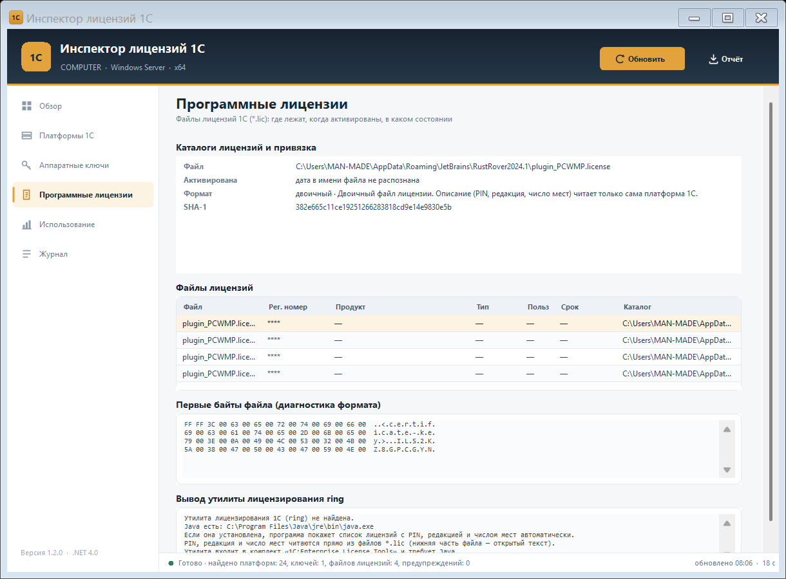

# Инспектор лицензий 1С

**Автор:** PrS · <bigsprut@mail.ru> · [github.com/bigsprut](https://github.com/bigsprut)

*English version: [README.en.md](../README.en.md)*

Неофициальная утилита для аудита лицензий **1С:Предприятие** на отдельном компьютере:
установленные платформы, аппаратные ключи защиты, программные лицензии, сеансы
и выданные им лицензии.

Один exe, без установки и внешних библиотек. Работает на **Windows Server 2003 x64**
(при установленном .NET Framework 4.0), на **Windows Server 2016/2019/2022** и на
Windows 7/8/10/11.


## Возможности

| Раздел | Что показывает |
|---|---|
| **Обзор** | Сводка: платформы, ключи, свободные места, файлы лицензий, предупреждения |
| **Платформы 1С** | Все установленные версии 8.0–8.3 и 7.7: разрядность, состав поставки, компоненты, путь |
| **Аппаратные ключи** | Sentinel LDK / HASP HL: ключи, компоненты, лимиты, занято и свободно, сеансы. HASP4 Net: служба, порт 475, версия, настройки, вывод HASPInfo и импорт отчёта `*.haspinfo` |
| **Программные лицензии** | Файлы `*.lic`: расположение, дата активации, размер, формат, SHA-1. Вывод утилиты `ring`, если она установлена |
| **Использование** | Процессы, службы, порты и вкладка **«Сеансы и лицензии»**: кто подключён, из какой базы, какую лицензию держит и сколько мест занято (через `rac`) |
| **Журнал** | Что и откуда удалось прочитать — помогает понять, почему данных нет |

Отчёт выгружается в **HTML** (для печати и пересылки) или **CSV**.

## Запуск

1. Скопируйте `1C-License-Inspector.exe` на компьютер и запустите.
2. Дождитесь окончания сканирования (2–5 секунд).
3. **Обновить** (F5) — повторное сканирование.
4. **Отчёт** (Ctrl+E) — сохранить HTML или CSV.

Права администратора желательны: иначе часть служб и защищённых каталогов может быть
недоступна, и программа честно об этом предупредит.

### Сеансы и лицензии (rac)

Вкладка **Использование → Сеансы и лицензии** показывает активные сеансы кластера
и лицензии, которые они держат: пользователь, компьютер, приложение, база, время начала,
тип и серия лицензии, занятые и общие места.

Для этого нужны:

- платформа **1С 8.3** на этом компьютере (в её составе есть `rac.exe`);
- запущенная служба **«1С:Предприятие. Сервер администрирования»** (`ras`, порт 1545);
- логин и пароль администратора кластера — если в кластере они заданы.

Поля «Сервер», «Логин» и «Пароль» находятся прямо на вкладке; пароль не сохраняется
и в отчёт не попадает. Если кластер не настроен, программа объяснит, чего не хватает.

### HASP4: состав ключа

Состав лицензий внутри ключа HASP4 (1С 7.7 / 8.2) производитель не публикует — его
показывает утилита **HASP Monitor** (HASP4 SDK) или сохранённый отчёт **HASPInfo**
(`*.haspinfo`). Программа:

- находит `haspinfo.exe` / `haspmntr.exe` в системе и показывает вывод `HASPInfo`;
- кнопкой **«Открыть HASP Monitor»** запускает графическую утилиту, если она установлена;
- кнопкой **«Загрузить отчёт HASPInfo…»** импортирует сохранённый отчёт, вытаскивает
  HASP ID и тип ключа и добавляет их в отчёт.

## Командная строка

```
1C-License-Inspector.exe /report:C:\Temp\licenses.html
1C-License-Inspector.exe /report:C:\Temp\licenses.html /csv:C:\Temp\licenses.csv /silent
```

| Ключ | Назначение |
|---|---|
| `/report:путь.html` | Собрать данные и сохранить HTML-отчёт, не открывая окно |
| `/csv:путь.csv` | Дополнительно сохранить CSV |
| `/silent` | Не показывать сообщения об ошибках (для планировщика) |
| `/ras:host:port` | Адрес сервера администрирования 1С (по умолчанию `localhost:1545`) |
| `/clusteruser:`, `/clusterpwd:` | Учётные данные администратора кластера для `rac` |
| `/page:N` | Открыть окно на разделе N (0 — обзор, 1 — платформы, …) |
| `/shot:путь.png`, `/shotsize:WxH` | Отрисовать окно в PNG (диагностика и скриншоты) |

Тихий режим удобно ставить в планировщик: отчёт будет обновляться сам.

## Что читается, а что нет

Программа работает только с документированными источниками: не подбирает пароли,
не обходит защиту и ничего не активирует.

- **Sentinel LDK / HASP HL** — читается полностью через локальный Admin API менеджера
  лицензий (порт 1947): ключи, компоненты, лимиты, занятые места, сеансы.
- **HASP4 Net** (1С 7.7 и 8.2) — служба, версия, порт 475 и настройки. Состав лицензий
  в ключе — только через HASP Monitor/HASPInfo (см. выше).
- **Программные лицензии** — файлы и их атрибуты. PIN, редакцию и число мест показывает
  утилита лицензирования 1С (`ring`) или диалог «Справка → О программе» в самой 1С.
- **Сеансы и лицензии** — через документированный `rac` (8.3) и сервер администрирования.
- **Свободные места** считаются по аппаратным ключам Sentinel LDK. В файле программной
  лицензии лимит мест не хранится в открытом виде.

## Скрипт для сервера с программными лицензиями

Если нужно собрать данные на рабочем сервере, не давая доступ, используйте
[`tools/Collect-LicenseData.ps1`](../tools/Collect-LicenseData.ps1). Скрипт **только читает**.

```powershell
powershell -ExecutionPolicy Bypass -File .\Collect-LicenseData.ps1
```

Результат — текстовый файл на Рабочем столе (`1c-license-data.txt`): ОС, платформы,
файлы `*.lic` (пути, даты, SHA-1), вывод `ring`, ветки реестра, службы, порты, сеансы `rac`.
Содержимое файлов лицензий в отчёт **не попадает** (только по ключу `-IncludeHex`).

## Сборка из исходников

Требуется .NET Framework 4.x (компилятор `csc.exe`). Внешних пакетов нет.

```powershell
.\build.ps1
```

Результат: `build\1C-License-Inspector.exe`. Иконка генерируется скриптом
`tools\make-icon.ps1`, манифест — `res\app.manifest`.

При сборке используется компилятор C# 4.0 и **API .NET 4.0** — чтобы exe запускался
на Server 2003 с .NET 4.0. Не поднимайте целевую версию платформы.

## Проверено

| Система | Результат |
|---|---|
| Windows Server 2003 R2 x64 SP2 (1С 7.7) | платформа 7.70.027 найдена, отчёт формируется, ошибок нет |
| Windows Server 2008 R2 (1С 8.2 + HASP4 Net) | 5 платформ, HASP LM 8.31, порт 475, Sentinel LDK 15.0 |
| Windows 11 Pro x64 | интерфейс, сканирование, отчёты, сеансы (на тестовых данных `rac`) |

## Ограничения

- Для Server 2003 нужен .NET Framework 4.0.
- `rac` есть только в платформе 8.3; для 8.2 список сеансов недоступен.
- Если кластер не отвечает по 1545 или задан пароль администратора, сеансы не читаются —
  программа покажет причину.
- Программа ничего не активирует, не удаляет и не изменяет.

## Автор и условия

Автор: **PrS**, <bigsprut@mail.ru>.

Утилита не связана с фирмой «1С» и распространяется как есть, без гарантий.
Названия «1С», «HASP», «Sentinel» принадлежат их правообладателям.
Лицензия на использование кода не предоставлена; по вопросам использования
напишите автору.

## Скриншоты

| Платформы | Аппаратные ключи |
|---|---|
|  |  |

| Программные лицензии | Сеансы и лицензии |
|---|---|
|  |  |
