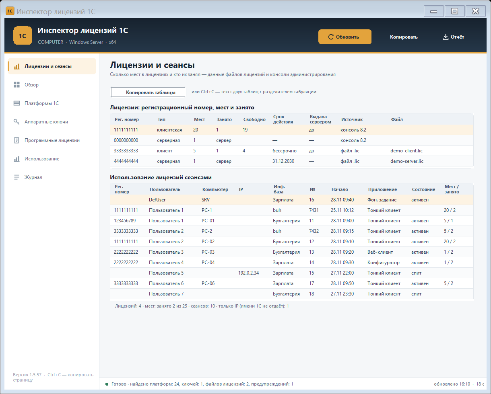
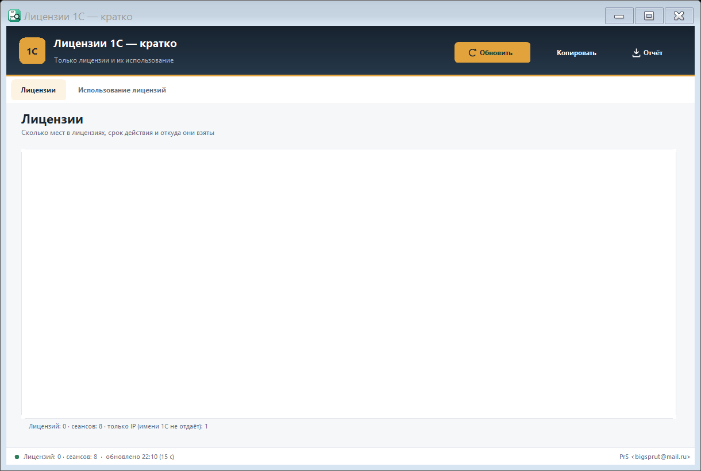
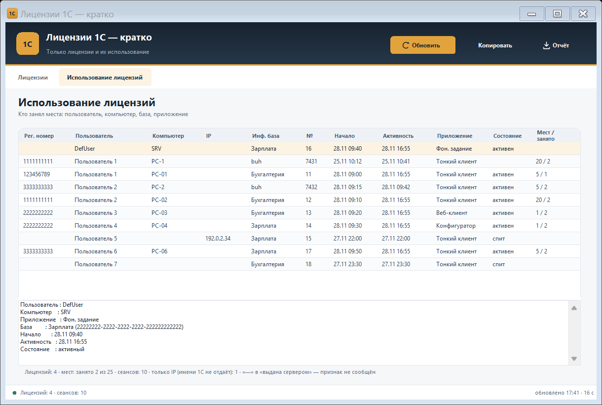
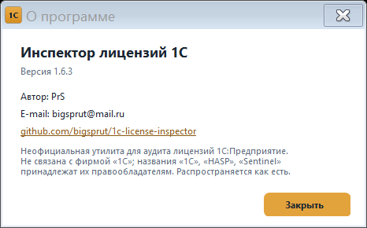
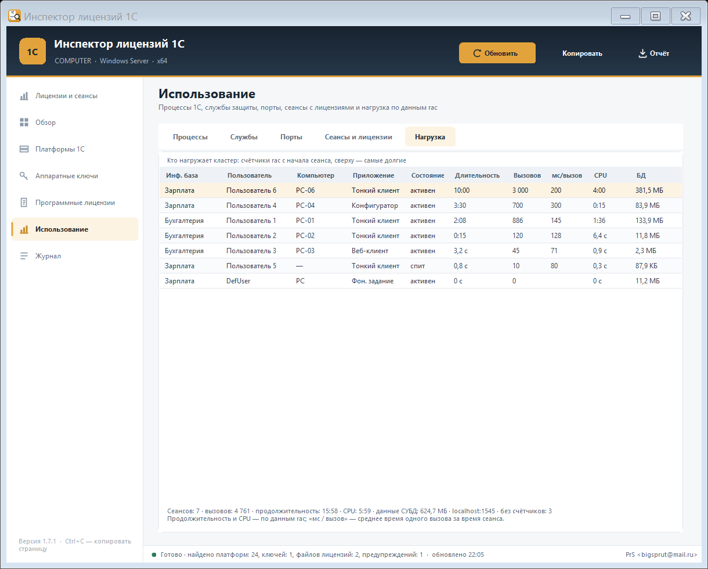
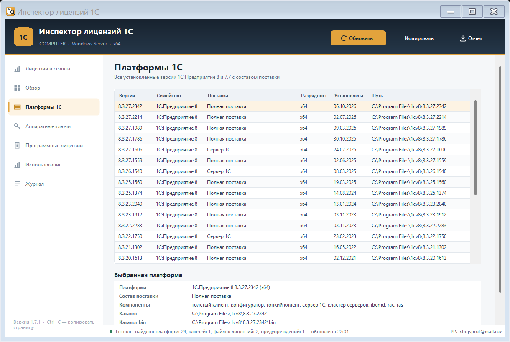
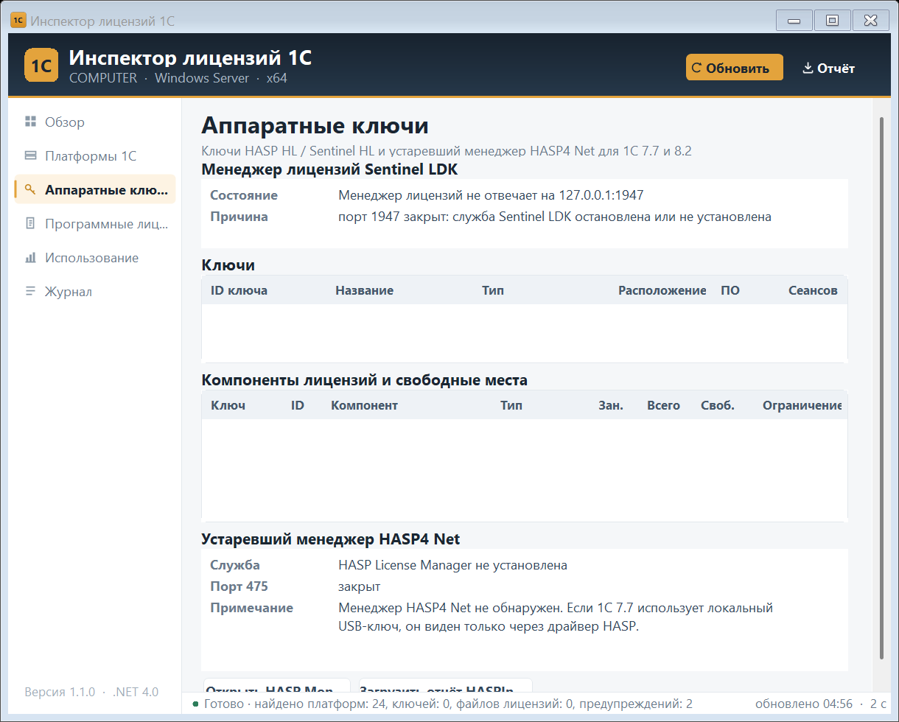
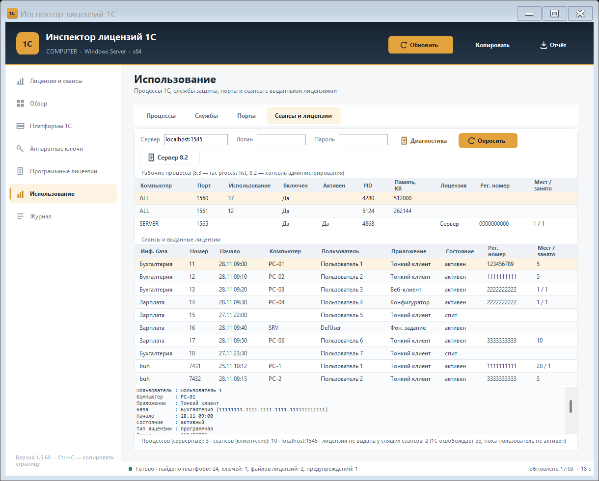
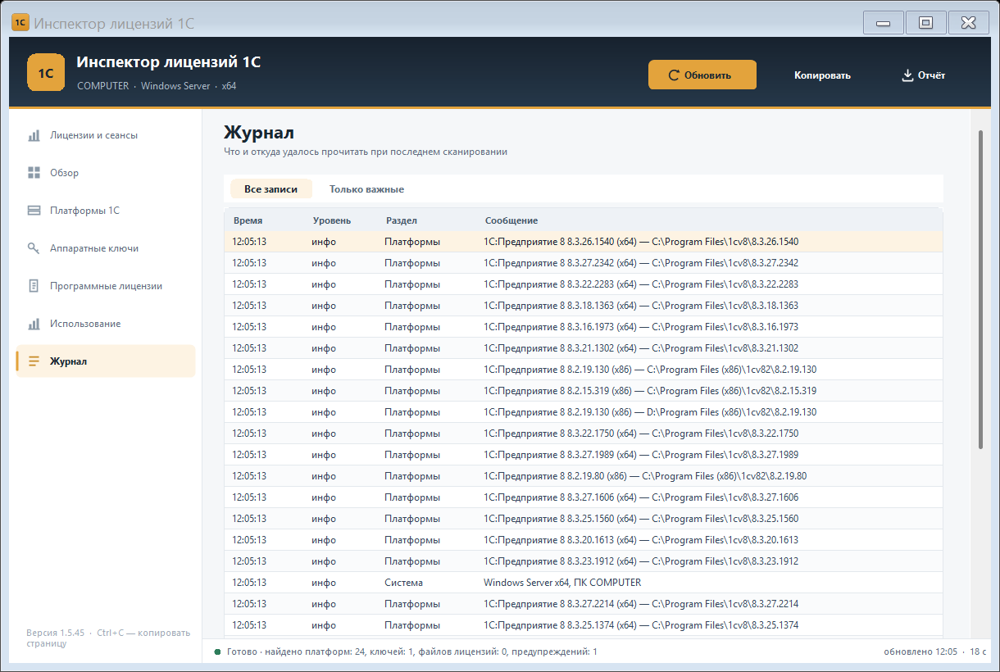

# Инспектор лицензий 1С

**Автор:** PrS · <bigsprut@mail.ru> · [github.com/bigsprut](https://github.com/bigsprut)

*English version: [README.en.md](../README.en.md)*

Неофициальная утилита для аудита лицензий **1С:Предприятие** на отдельном компьютере:
установленные платформы, аппаратные ключи защиты, программные лицензии, сеансы
и выданные им лицензии.

Один exe, без установки и внешних библиотек. Работает на **Windows Server 2003 x64**
(при установленном .NET Framework 4.0), на **Windows Server 2016/2019/2022** и на
Windows 7/8/10/11.



## Возможности

| Раздел | Что показывает |
|---|---|
| **Лицензии и сеансы** | Открывается при запуске: какие лицензии есть (рег. номер, тип, мест, занято, свободно, срок действия, выдана ли сервером) и кто их занял — сеансы с пользователем, компьютером, адресом, базой, приложением, состоянием и временем последней активности |
| **Обзор** | Сводка: платформы, ключи, свободные места, файлы лицензий, предупреждения |
| **Платформы 1С** | Все установленные версии 8.0–8.3 и 7.7: разрядность, состав поставки, компоненты, путь |
| **Аппаратные ключи** | Sentinel LDK / HASP HL: ключи, компоненты, лимиты, занято и свободно, сеансы. HASP4 Net: служба, порт 475, версия, настройки, вывод HASPInfo и импорт отчёта `*.haspinfo` |
| **Программные лицензии** | Файлы `*.lic`: расположение, дата активации, размер, формат, SHA-1, а для 8.3 — рег. номер, тип, число мест и срок действия из самого файла. Вывод утилиты `ring`, если она установлена |
| **Использование** | Процессы, службы, порты, вкладка **«Сеансы и лицензии»** (кто подключён, из какой базы, какую лицензию держит и сколько мест занято) и вкладка **«Нагрузка»** — кто реально нагружает кластер: длительность вызовов, процессорное время и объём данных из СУБД (через `rac`) |
| **Журнал** | Что и откуда удалось прочитать — помогает понять, почему данных нет |

Отчёт выгружается в **HTML** (для печати и пересылки) или **CSV**.

## Краткое приложение: только лицензии и их использование

Рядом лежит второй exe — **`1C-License-Inspector-Lite.exe`** (появился в 1.6.0). В нём
всего две вкладки, и он не собирает то, что не нужно этим таблицам: аппаратные ключи
Sentinel/HASP4, службы, порты. За счёт этого стартует заметно быстрее полного.

| Вкладка | Что показывает |
|---|---|
| **Лицензии** | Рег. номер, тип, мест, занято, свободно, срок действия, «выдана сервером», источник и файл |
| **Использование лицензий** | Кто занял места: пользователь, компьютер, адрес, база, приложение, состояние, мест/занято; ниже — карточка выбранного сеанса, в ней же счётчики нагрузки (вызовы, длительность, CPU, данные) |





Запуск — `Запустить-кратко.cmd` (берёт `build\`, иначе `dist\`). Общие данные: оба
приложения считают таблицы одним и тем же кодом, поэтому цифры в них не расходятся.

## Автор

**PrS** — <bigsprut@mail.ru> · [github.com/bigsprut](https://github.com/bigsprut)

Авторство видно и в самом приложении: подпись **PrS <bigsprut@mail.ru>** в строке состояния
(щелчок по ней открывает «О программе», оно же по **F1**), в свойствах exe (компания и авторские
права), в HTML-отчёте и в текстовом дайджесте.


## Запуск

1. Скопируйте `1C-License-Inspector.exe` на компьютер и запустите.
2. Дождитесь окончания сканирования (2–5 секунд).
3. **Обновить** (F5) — повторное сканирование.
4. **Отчёт** (Ctrl+E) — сохранить HTML или CSV.

Права администратора желательны: иначе часть служб и защищённых каталогов может быть
недоступна, и программа честно об этом предупредит.

Окно можно увеличить: таблицы сеансов и лицензий растягиваются вместе с ним и показывают
больше строк (с 1.5.60) — удобно, когда в кластере десятки подключений.

### Сеансы и лицензии (rac)

Вкладка **Использование → Сеансы и лицензии** показывает активные сеансы кластера
и лицензии, которые они держат: пользователь, компьютер, приложение, база, время начала,
рег. номер лицензии, «мест / занято» и время последней активности. Под таблицей — карточка выбранного сеанса: адрес
клиента, тип и серия лицензии, выдана ли сервером, места и последняя активность.

В таблице лицензий на первой странице у каждой лицензии видны **срок действия** (из файла
`*.lic`; «не ограничен» показывается как «бессрочно») и признак **«выдана сервером»**
(`issued-by-server` из данных сеансов: лицензию предоставил сервер лицензий, а не локальный
ключ на компьютере пользователя). Прочерк «—» означает, что источник этот признак не сообщает:
у 1С 8.2 в консоли администрирования такого поля нет вовсе, поэтому там всегда прочерк —
это «неизвестно», а не «лицензия локальная».

У **спящего** сеанса (`hibernate: yes`) платформа не сообщает имя компьютера вообще —
ни в списке сеансов, ни в списке соединений (соединение у спящего сеанса уже нулевое).
Программа показывает то, что платформа реально отдаёт, — **адрес клиента** (`client-ip`),
и честно пишет, что имени нет. Для внутренних (частных) адресов из диапазонов RFC 1918
она дополнительно пробует обратный DNS: если в домене для машины есть PTR-запись,
в столбце «Компьютер» появится её имя, а адрес останется в столбце «IP».

Для этого нужны:

- платформа **1С 8.3** на этом компьютере (в её составе есть `rac.exe`);
- запущенная служба **«1С:Предприятие. Сервер администрирования»** (`ras`, порт 1545);
- логин и пароль администратора кластера — если в кластере они заданы.

Поля «Сервер», «Логин» и «Пароль» находятся прямо на вкладке; пароль не сохраняется
и в отчёт не попадает. Если кластер не настроен, программа объяснит, чего не хватает.

### Нагрузка сеансов (rac)

Вкладка **Использование → Нагрузка** отвечает на вопрос «кто нагружает сервер», а не
только «кто подключён»: те же сеансы, но со счётчиками `rac`, отсортированные по
длительности — сверху тот, кто действительно работает. Внизу таблицы — итог по всем сеансам.

| Столбец | Поле `rac` | Что значит |
|---|---|---|
| **Длительность** | `duration-all` | Суммарное время вызовов сеанса с его начала |
| **Вызовов** | `calls-all` | Сколько вызовов сеанс сделал |
| **мс/вызов** | — | Среднее время одного вызова (длительность ÷ вызовы) |
| **CPU** | `cpu-time-total` | Процессорное время, которое сожгли вызовы сеанса |
| **БД** | `dbms-bytes-all` | Сколько данных сеанс прочитал из СУБД и записал в неё |

В карточке сеанса на вкладке «Сеансы и лицензии» те же цифры разложены подробнее:
сколько времени ушло **в СУБД** (`duration-all-dbms`), сколько — **в коде 1С**
(`duration-all-service`), и сколько данных передано **клиенту** (`bytes-all`).

Счётчики — накопительные, с начала сеанса, а не «за последнюю минуту». Поля есть только
в 1С 8.3; у 8.2 их не существует, поэтому вкладка честно пишет, что кластер их не отдал,
а не показывает нули.



### HASP4: состав ключа

Состав лицензий внутри ключа HASP4 (1С 7.7 / 8.2) производитель не публикует — его
показывает утилита **HASP Monitor** (HASP4 SDK) или сохранённый отчёт **HASPInfo**
(`*.haspinfo`). Программа:

- находит `haspinfo.exe` / `haspmntr.exe` в системе и показывает вывод `HASPInfo`;
- кнопкой **«Открыть HASP Monitor»** запускает графическую утилиту, если она установлена;
- кнопкой **«Загрузить отчёт HASPInfo…»** импортирует сохранённый отчёт, вытаскивает
  HASP ID и тип ключа и добавляет их в отчёт.

## Командная строка

```
1C-License-Inspector.exe /report:C:\Temp\licenses.html
1C-License-Inspector.exe /report:C:\Temp\licenses.html /csv:C:\Temp\licenses.csv /silent
```

| Ключ | Назначение |
|---|---|
| `/report:путь.html` | Собрать данные и сохранить HTML-отчёт, не открывая окно |
| `/csv:путь.csv` | Дополнительно сохранить CSV |
| `/silent` | Не показывать сообщения об ошибках (для планировщика) |
| `/ras:host:port` | Адрес сервера администрирования 1С (по умолчанию `localhost:1545`) |
| `/clusteruser:`, `/clusterpwd:` | Учётные данные администратора кластера для `rac` |
| `/page:N` | Открыть окно на разделе N (0 — лицензии и сеансы, 1 — обзор, 2 — платформы, …) |
| `/shot:путь.png`, `/shotsize:WxH` | Отрисовать окно в PNG (диагностика и скриншоты) |

Тихий режим удобно ставить в планировщик: отчёт будет обновляться сам.

## Что читается, а что нет

Программа работает только с документированными источниками: не подбирает пароли,
не обходит защиту и ничего не активирует.

- **Sentinel LDK / HASP HL** — читается полностью через локальный Admin API менеджера
  лицензий (порт 1947): ключи, компоненты, лимиты, занятые места, сеансы.
- **HASP4 Net** (1С 7.7 и 8.2) — служба, версия, порт 475 и настройки. Состав лицензий
  в ключе — только через HASP Monitor/HASPInfo (см. выше).
- **Программные лицензии** — файлы и их атрибуты. В файлах 1С 8.3 внизу открыто записаны
  рег. номер, тип лицензии, срок действия, число мест и привязка — программа их показывает.
  Файлы **8.2 зашифрованы**, там PIN, редакцию и число мест даёт утилита лицензирования `ring`
  или диалог «Справка → О программе» в самой 1С.
- **Сеансы и лицензии** — через документированный `rac` (8.3) и сервер администрирования.
- **Свободные места** считаются по аппаратным ключам Sentinel LDK и по числу мест из файлов 8.3;
  у зашифрованных файлов 8.2 лимит мест в открытом виде не хранится.

## Скрипт для сервера с программными лицензиями

Если нужно собрать данные на рабочем сервере, не давая доступ, используйте
[`tools/Collect-LicenseData.ps1`](../tools/Collect-LicenseData.ps1). Скрипт **только читает**.

```powershell
powershell -ExecutionPolicy Bypass -File .\Collect-LicenseData.ps1
```

Результат — текстовый файл на Рабочем столе (`1c-license-data.txt`): ОС, платформы,
файлы `*.lic` (пути, даты, SHA-1), вывод `ring`, ветки реестра, службы, порты, сеансы `rac`.
Содержимое файлов лицензий в отчёт **не попадает** (только по ключу `-IncludeHex`).

## Сборка из исходников

Требуется .NET Framework 4.x (компилятор `csc.exe`). Внешних пакетов нет.

```powershell
.\build.ps1
```

Результат: `build\1C-License-Inspector.exe`; та же сборка копируется в `dist\1C-License-Inspector.exe` (файл релиза) и сверяется по SHA-256. Иконка генерируется скриптом
`tools\make-icon.ps1`, манифест — `res\app.manifest`.

Каждый тег `v*` автоматически собирается в GitHub Actions и прикрепляется к релизу.

При сборке используется компилятор C# 4.0 и **API .NET 4.0** — чтобы exe запускался
на Server 2003 с .NET 4.0. Не поднимайте целевую версию платформы.

## Проверено

| Система | Результат |
|---|---|
| Windows Server 2003 R2 x64 SP2 (1С 7.7) | платформа 7.70.027 найдена, отчёт формируется, ошибок нет |
| Windows Server 2008 R2 (1С 8.2 + HASP4 Net) | 5 платформ, HASP LM 8.31, порт 475, Sentinel LDK 15.0 |
| Windows 11 Pro x64 | интерфейс, сканирование, отчёты, сеансы (на тестовых данных `rac`) |

## Ограничения

- Для Server 2003 нужен .NET Framework 4.0.
- `rac` есть только в платформе 8.3; для 8.2 список сеансов недоступен.
- Если кластер не отвечает по 1545 или задан пароль администратора, сеансы не читаются —
  программа покажет причину.
- Программа ничего не активирует, не удаляет и не изменяет.

## Если программа не запустилась

Рядом с exe (или в `%TEMP%`) создаются два файла диагностики:

- `1c-license-inspector.log` — шаги запуска и сканирования;
- `1c-license-inspector-crash.log` — текст ошибки, если запуск прервался.

Пришлите их — по ним видно, на каком шаге и на каком элементе интерфейса произошёл сбой.

## Аппаратные ключи, служба Sentinel LDK и ring

- Наличие USB-ключа программа определяет **сама по себе**, даже когда служба
  `Sentinel LDK License Manager` (`hasplms`) выключена: в карточке появится
  «USB-ключ Sentinel HASP Key (USB)» и пояснение, что состав не прочитать.
- Если служба остановлена — нажмите в разделе «Аппаратные ключи» кнопку
  **«Запустить службу Sentinel»** и обновите (F5). Обычно служба должна быть
  в состоянии «Работает», тип запуска — «Вручную».
- Если Admin API менеджера лицензий закрыт (403), программа читает ключи через
  веб-интерфейс ACC (`tab_dev.html` / `tab_feat.html`) — это тот же источник,
  что и страница `http://localhost:1947`.
- PIN, редакцию и число мест **программных** лицензий у 1С 8.3 программа читает из самого
  файла `*.lic` — внизу он открытый. У **8.2** файлы зашифрованы, и там нужна утилита
  лицензирования `ring` из комплекта «1C:Enterprise License Tools» (ей нужна Java,
  проверяется автоматически) либо диалог «Справка → О программе» в самой 1С. Без этого
  у 8.2 видны только файлы `*.lic`, их размер, дата и каталог.

## Сеансы 1С на сервере

Список активных сеансов и занятых лицензий читается через `rac` и требует:

- платформу **8.3** (в 8.2 утилиты `rac` нет);
- запущенную службу **«Сервер администрирования 1С»** (`ras`, порт 1545).

Проверка на сервере: `netstat -an | findstr 1545`. Если порт не слушается —
запустите `ras.exe --port=1545` (или службу администрирования). Сеансы файловых
баз в кластере не видны — только серверные.

### Сервер только с 8.3

- Программа сама находит `rac.exe` и `ras.exe` установленной платформы 8.3.
- Если `ras` не запущен, а **агент 8.3 работает**, программа поднимает
  `ras.exe --port=1545` (нужны права администратора) и читает кластеры, сеансы и
  выданные лицензии. Если поднять не удалось — покажет точную команду.
- Лицензии 8.3: файлы `*.lic` (каталоги, количество, даты, **срок действия**), аппаратные ключи
  Sentinel HL через LDK, PIN/редакция/места программных лицензий — из самих файлов `*.lic`.

## История изменений

**1.7.0** — вкладка «Нагрузка» на странице «Использование»: счётчики `rac` по сеансам —
длительность вызовов, их количество, среднее время вызова, процессорное время и объём данных
из СУБД; сверху самый долгий сеанс, внизу итог. Те же цифры — в карточке сеанса (полное и краткое
приложение) с разбивкой времени на СУБД и код 1С, и в дайджесте строкой `нагрузка=…`.

**1.6.3** — авторство PrS в одном месте: подпись в строке состояния (щелчок открывает «О программе»),
окно **«О программе»** по **F1**, футер HTML-отчёта, первая строка дайджеста, свойства exe
(компания и авторские права), `AUTHORS.txt` и разделы «Автор» в README.

**1.6.2** — у полного и краткого приложений **разные иконки** (янтарная и бирюзовая с полоской
«вкладок»); обработчик на сервере держит копию exe с версией в имени — Windows больше не
показывает старую иконку из кэша.

**1.6.1** — столбец **«Активность»** (`last-active-at` из `rac`) во всех таблицах сеансов и в карточке.

**1.6.0** — **краткое приложение** `1C-License-Inspector-Lite.exe`: две вкладки — «Лицензии»
и «Использование лицензий». Не собирает аппаратные ключи, службы и порты, поэтому стартует
быстрее; таблицы считает тот же код, что и полная версия.

**1.5.60** — страницы растягиваются вместе с окном: при большом окне видно больше строк
таблиц сеансов, вкладок «Использования» и журнала.

**1.5.59** — «выдана сервером» больше не врёт: пустое значение показывается как «—», а не «нет».

**1.5.58** — пятая страница «Использование»: «Мест / занято» одной колонкой, убраны пустые
и дублирующие столбцы, лицензионные столбцы у рабочих процессов скрываются, если данных нет.

**1.5.57** — на первой странице в таблице лицензий появились **срок действия** (из файла `*.lic`)
и **выдана сервером**; из таблицы сеансов убраны лишние столбцы, чтобы подписи помещались.

**1.5.56** — у **спящего** сеанса имя компьютера берётся из `client-ip` (в `rac` его нет),
для приватных адресов пробуется обратный DNS; появился столбец «IP».

**1.5.34–1.5.55** — вёрстка таблиц и карточек, «Мест / занято», высоты строк по содержимому,
мелкие исправления по итогам прогонов на Server 2003 и 2008 R2.

**1.5.28–1.5.33** — диагностика `rac` (режим `/racprobe` и отчёт для разбора), выбор версии `rac`
по работающему `ras`, добор лицензий через `session info --licenses`, имена информационных баз,
рабочие процессы, скрытие пустых столбцов. Аудит интерфейса этого периода — `docs/UI-AUDIT.md`
(исторический документ, актуален по 1.5.33).

**1.5.0–1.5.27** — сеансы 8.2 из консоли администрирования, разбор строк лицензий
(`Сервер, <PIN> <занято> <всего>`), поля сеансов 8.3, синтаксис `rac` 8.3.27, порт `ras` 1545.

**1.4.0–1.4.4** — автоматический сбор таблиц из консоли 8.2 через MMC 2.0, без ручного копирования;
один exe, 8.2 читается при обычном сканировании.

**1.3.0–1.3.4** — импорт таблиц консоли 8.2, PIN и места отдельными столбцами, серверная
и клиентские лицензии отдельно, импорт в отчёте.

**1.2.0–1.2.3** — PIN и количество мест читаются из файла `*.lic` без утилиты `ring`,
занято и свободно, копирование таблиц.

**1.1.8–1.1.9** — сводка количества найденных лицензий.

**1.1.7** — сервер только с 8.3: программа сама поднимает `ras.exe --port=1545`, если агент 8.3
работает, и сразу читает кластеры и сеансы; если не вышло — подсказывает команду.

**1.1.6** — показывается количество найденных устройств HASP: сколько ключей HASP4 и сколько
Sentinel HL (включая «с ошибкой драйвера»).

**1.1.5** — диагностика 8.2 и HASP4: если на сервере работает агент 8.2, программа пишет,
что `rac` его сеансы не видит (нужна консоль администрирования 8.2); если ключ обслуживает
HASP4 (порт 475), пишет, что количество мест показывает только HASP Monitor.

**1.1.4** — аппаратные ключи видны и при выключенной службе (по USB), при закрытом Admin API
читаются через веб-интерфейс ACC; кнопки «Запустить службу Sentinel» и «Открыть ACC»;
в программных лицензиях показывается Java и понятное объяснение про `ring`; в сеансах —
требования `ras`/8.3.

**1.1.3** — настоящая причина незапуска на Server 2003/2008 найдена и устранена: в сборке был
атрибут `AssemblyMetadata`, появившийся только в .NET Framework 4.5. На серверах стоит 4.0 —
CLR зависал при создании окна. Атрибут убран, проверено на обеих машинах: форма показывается,
все страницы открываются. Дополнительно: окна таблиц создаются после появления формы, страницы —
по требованию, шрифты в пикселях, высоты карточек по содержимому.

**1.1.2** — промежуточные исправления вёрстки и создания окон (запуск не решали).

**1.1.0** — сеансы и лицензии через `rac`, HASPInfo/HASP Monitor.

## Автор и условия

Автор: **PrS**, <bigsprut@mail.ru>.

Утилита не связана с фирмой «1С» и распространяется как есть, без гарантий.
Названия «1С», «HASP», «Sentinel» принадлежат их правообладателям.
Лицензия на использование кода не предоставлена; по вопросам использования
напишите автору.

## Скриншоты

| Платформы | Аппаратные ключи |
|---|---|
|  |  |

| Программные лицензии | Сеансы и лицензии |
|---|---|
|  |  |
|  |  |
|  |  |
